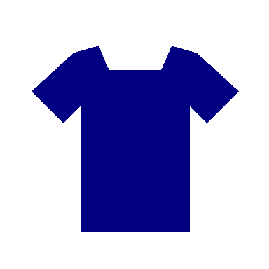

# Entrée et sortie réelles OpenAI — 25 octobre 2026

La réponse du premier contrôle n'avait pas été conservée intégralement. Pour cet exemple, le même dessin est recréé à l'identique et un nouvel appel réel est effectué avec backend/.env et gpt-5.4-mini. Sa réponse peut différer de la précédente.

## Image envoyée

PNG de 384 × 384 pixels, transmis en base64. Aucune photo privée et aucune écriture Supabase.

## Sortie reçue

- [JSON retourné par le modèle](output-model.json) : réponse réelle, **non corrigée et rejetée par le validateur**.
- [Réponse API OpenAI complète](raw-response.json) : enveloppe Responses, sortie textuelle JSON et usage.
- [Requête JSON envoyée](request.json) : prompt, modèle, schéma et image base64, sans en-têtes d'authentification.
- [Résultat de validation](validation.json) : provider_invalid_output, indicateurs attendus/reçus/manquants.

HTTP 200 et réponse OpenAI completed. Catégorie clothes, type tshirt, confiance retournée 1 ; taille/public/saison et dates inconnus. Le modèle retourne cinq indicateurs alors que le contrat en exige sept : **le backend rejette cette analyse**. Aucune analyse valide n'est persistée ; aucune décision d'acceptation/refus n'est produite. Le bon résultat du premier appel ne garantit donc pas que les sorties suivantes respectent toutes les règles métier supplémentaires au schéma JSON.

Cette image synthétique ne mesure pas la qualité sur de vraies photos. Un appel API supplémentaire a été consommé pour obtenir et conserver cet exemple. Aucun résultat ou indicateur manquant n'a été inventé pour rendre la réponse valide.
